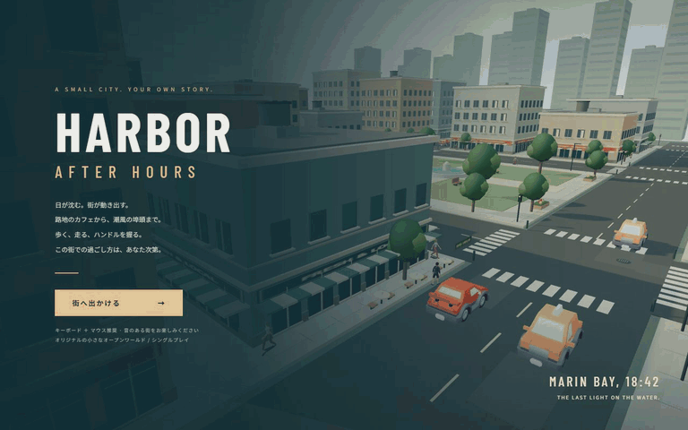

# HARBOR — After Hours

夕暮れの港町「マリン湾」を歩き、車を走らせ、小さな仕事を引き受ける、ブラウザ向け3Dオープンワールドゲームです。商店街、中央公園、倉庫街、海沿いの遊歩道を、落ち着いた青緑と暖かな砂色のローポリアートでまとめました。GTAシリーズの「自由に都市を移動する楽しさ」に着想を得たオリジナル作品で、原作のキャラクター、地名、マップ、音楽、ロゴは使用していません。



GIFは実行中のChrome/WebGL画面を連続キャプチャし、Pillowで変換したものです。キーボードとマウスで、徒歩・乗降・運転・射撃を実際に操作しています。架空の映像・画像生成・録画中のテレポートは使用していません。GIFには音声がありません。収録情報は [docs/recording.json](docs/recording.json) にあります。

## 遊ぶ

Node.js 22.12以上を推奨。デスクトップのChrome/Edge、WebGL2、キーボードとマウスが必要です。

```sh
npm install
npm run dev
```

[http://localhost:5181](http://localhost:5181) を開き、「街へ出かける」をクリックしてください。最初のセダンは主人公のすぐそばにあり、Eで乗れます。Mで依頼を開始します。依頼を受けずに自由探索もできます。

配布用ビルド：

```sh
npm run build
npm run preview
```

プレビューは [http://localhost:4181](http://localhost:4181)。`dist/` を静的ホスティングのルートに配置できます。モデル・フォント・音響処理はローカル同梱で、起動後に外部CDNやAPIへ接続する必要はありません。HTMLを`file://`で直接開かず、HTTPサーバーを使用してください。

## 操作

| 操作 | 入力 |
|---|---|
| 歩く / アクセル・後退・操舵 | WASD / 矢印キー |
| 走る | Shift |
| カメラ | マウス移動。クリックでポインター固定、ドラッグでも操作可 |
| 車の乗降 / 救護所の利用 | E |
| 武器の装備・収納 | Q |
| 照準 | 右マウスボタン長押し |
| 射撃 | 左マウスボタン長押し |
| リロード | R |
| ハンドブレーキ | Space |
| 次のミッション開始 | M |
| カメラを背後へ戻す | C |
| HUD非表示 / 再表示 | H |
| ポーズ・操作説明・画質 / 音設定 | Esc |

車は十分に減速してから降りてください。HPと弾薬は公園南西の「MARIN AID」で補給できます。画面が重い場合はEscメニューで画質をLOWへ変更できます。

## 街とゲームシステム

- 約220m四方の地区。商店の看板、ショーウィンドー、ひさし、窓枠、屋上設備、非常階段、街路樹、自転車、ベンチ、バス停、横断歩道、港のクレーンと小船を配置。
- 外部のスキニング済み人物モデル5種類。男性・女性の歩行者30人が歩道を移動。歩行・走行・待機・銃の構え・射撃・倒れるアニメーションをブレンド。
- Kenneyの車モデル3種類。通常交通12台と利用可能なカフェのセダン。加速、惰性、後退、速度に応じた操舵、ハンドブレーキ、車体傾斜、車輪回転、衝突を実装。
- 交通車両は道路経路を循環し、交差点手前で時間交替の通行待ち、前車との車間距離に応じた減速を行います。
- 12発のサイドアーム、予備弾薬、リロード、HP、照準カメラ、反動、発射音、マズルフラッシュ、弾道と着弾エフェクト。
- 敵は倉庫の遮蔽物と射撃位置の間を動き、視線が通る場合に射撃します。壁や大きな箱は弾道・視線を遮ります。流血表現はありません。
- 発砲、車両強奪、警察への射撃で手配度が上昇。最大5つの星。手配度で警官・パトカー数と追跡速度が変わります。
- 初回通報から出動まで猶予があります。警察の視線を遮り、犯罪行為を止めて隠れると、9秒の捜索周期ごとに手配が下がります。複数の星では複数周期が必要です。
- 無装備のまま警官に密着すると逮捕。死亡・逮捕時は$100を差し引いて救護所へ復帰し、警察を解除。進行中の依頼はMで再挑戦できます。
- 環境音、足音、エンジン、サイレン、銃声、UI音はWeb Audioによる合成。マスター音量をOFFにできます。
- 所持金とクリア累計は同じブラウザのlocalStorageに保存。位置や進行中ミッションは保存しません。

## 3つの短い物語

| ミッション | クリア条件 | 報酬 |
|---|---|---|
| 夕暮れの配達人 | 車で埠頭の黄色い印に到達し停車 | $350 |
| 埠頭の用心棒 | 倉庫街の武装NPC3人を制圧 | $600 |
| 夜にまぎれて | 警察の追跡を振り切り、公園の救護所へ到達 | $500 |

最後の仕事を終えると、再び最初の依頼を遊べます。敵の制圧には追加報酬があります。黄色のマーカーとミニマップを道しるべにしてください。

## 使用技術と素材

JavaScript ES Modules / Three.js 0.180.0 / Vite 7.3.7 / WebGL2 / Web Audio API / Playwright 1.56.1 / Python + Pillow（GIF変換）。物理エンジンは使用せず、区間分割した衝突移動、車両操舵、道路経路AI、視線の交差判定を実装しています。静的街並みは材質単位で結合し、描画呼び出しを抑えています。

| 素材 | 作者・配布元 | ライセンス |
|---|---|---|
| Casual_Hoodie、Casual_2、Suit、Swatと24種類のアニメーション | [Quaternius / Ultimate Modular Men](https://quaternius.com/packs/ultimatemodularcharacters.html) | CC0 1.0 |
| Casual（女性）とアニメーション | [Quaternius / Ultimate Modular Women](https://quaternius.com/packs/ultimatemodularwomen.html) | CC0 1.0 |
| Sedan Sports、Taxi、Police | [Kenney / Car Kit](https://kenney.nl/assets/car-kit) | CC0 1.0 |
| Barlow Condensed | [Jeremy Tribby / Google Fonts](https://github.com/google/fonts/tree/main/ofl/barlowcondensed) | SIL OFL 1.1 |

Quaternius作者のGoogle Drive配布がダウンロード上限に達していたため、[agentkaerf/FreeModels](https://github.com/agentkaerf/FreeModels) の同一CC0パックを取得しました。車両GLBは [Hidencod/tge-assets](https://github.com/Hidencod/tge-assets/tree/main/packs/car-kit) のKenney変換版です。作者公式のライセンスと各ファイルの取得元・SHA-256を同梱しています。

- [人物ライセンス](public/assets/QUATERNIUS-LICENSE.txt)
- [女性人物ライセンス](public/assets/QUATERNIUS-WOMEN-LICENSE.txt)
- [車両ライセンス](public/assets/KENNEY-LICENSE.txt)
- [フォントライセンス](public/fonts/OFL.txt)
- [素材一覧・ハッシュ](docs/assets.json)

建物、道路設備、UI、銃の小物、音響は本制作でコードから作成したものです。意図的なローポリアートを採用しています。写真調の人間・車両を再現する作品ではありません。

## AIサービスとモデル

- 使用サービス：**OpenAI Codex デスクトップアプリ**。
- モデル名：実行環境の上位指示で確認できる名称は **GPT-6**。細かなモデルバリアント、APIモデルID、スナップショット識別子はこのセッションから取得できず、未確認です。推測で別のモデル名を記載していません。
- 画像生成、音楽生成、外部LLMのゲーム内実行は使用していません。
- 素材は上記作者の既存CC0モデルであり、AIが制作したモデルと偽っていません。

## 制作記録・検証

時刻は日本標準時（Asia/Tokyo）。このセッションで確認できた開始時刻は **2026-10-21 08:53:43 JST**。作業フォルダーには08:50作成の準備ファイルがありましたが、その前の作業時間は正確に取得できないため経過時間に加えていません。終了日時・経過時間は [docs/production.json](docs/production.json) を参照してください。

制作終了：**2026-10-21 09:26:17 JST**。上記の確認可能な開始時刻からの経過時間：**32分34秒**。基本回帰10項目、ミッション4項目、実走行1項目、本番ビルド1項目の合計16項目が通過しています。最終GIFは768×480、81フレーム、約15.4秒です。

基本実装後に、次の改善と再検証を行いました。

1. 実画面で初期プレイヤーと建物の重なりを発見。開始位置を歩道脇へ修正し、追従カメラの距離が極端に詰まる問題を解消。
2. 射撃カメラが地面を向きすぎる問題を修正。照準時は肩越しの視線方向を独立させ、武器は手首のボーンへ装着。
3. 店舗側面の空白を、ショーウィンドー・看板・ひさしで改善。路面粒子、マンホール、自転車、植栽、カフェテーブル、遠景の窓、小船を追加。
4. 夕方の光色と太陽高度を調整し、UIの青緑・金色・生成りと街の配色を統一。タイトル画面にゲームHUDが重なる問題を修正。
5. 歩道と道路に応じた人物の高さ、乗車前の動作、車両カメラの追従を改善。遠くの人物にも無条件に描画していた処理を見直し。
6. 実射撃テストで戦闘の難しさを確認し、敵HP、攻撃間隔、警察到着の猶予を調整。障害物にぶつかった敵の回り込みを追加。
7. 警察車両が追跡経路の終点で旋回を続ける挙動を修正。終了時は道路上で停車するよう改善。
8. 導入時の依存関係監査でViteの問題を確認し、同メジャーの修正版7.3.7へ更新。更新後のnpm監査は脆弱性0件。
9. Google Fontsの外部読み込みをやめ、OFLフォントをローカル同梱。日本語はOSのフォントを利用。
10. 最終スクリーンショットで交差点の車両同士の重なりを発見。進行前後の距離を検査して重なり方向の移動を戻し、パトカーの生成位置にも間隔を確保。修正後は初期地点からの配達をHP100のまま完了しました。

検証はWindowsのデスクトップChromeをPlaywrightから実際に起動し、WebGL描画を目視確認しながら行いました。

| 検証 | 方法と記録 |
|---|---|
| 人物・街・車・照準の見た目 | 実画面のPNG確認、修正、再撮影 |
| 歩行・走行・衝突 | 実キーボード入力、座標と移動量の検証 |
| 車の乗降・加速・制動・下車 | 実キーボード入力と状態検証 |
| 配達ミッション | **初期地点から座標操作なしで全区間を運転し、停車してクリア**。[記録](docs/driving-test.json) |
| 戦闘・リロード・反動・敵制圧 | 実マウス射撃。敵の位置を読み取った照準設定、遮蔽物のあるテスト場面の座標セットアップを併用。[記録](docs/mission-tests.json) |
| 逃走・手配低下・救護所ゴール | 隠れ場所の座標セットアップ後、ゲームの実時間進行で捜索解除を待ち、終点を検証 |
| 逮捕・死亡・罰金・復帰 | テスト用の近接位置 / HP設定と実際の判定ループで確認 |
| NPC避難・警察増援・交通継続 | 発砲後の人口・状態・車両位置と速度を確認 |
| ポーズ・再開 | 入力を止め、ポーズ中に世界が進まないことを確認 |
| ビルド・実行時エラー | Vite本番ビルド、ブラウザpageerror検査 |
| 本番ビルド・カメラ・狭幅UI | `dist/`から起動。実行時エラー、読み込み失敗、外部通信0件。建物脇のカメラ位置と800×600のメニューを確認。[記録](docs/production-test.json) |

通常の回帰テストは [docs/test-results.json](docs/test-results.json)、ミッション検証は [docs/mission-tests.json](docs/mission-tests.json) に保存しています。`?test`で起動した場合のみ検証用の`window.__game`が公開されます。通常の起動では公開されません。テストに使った座標・HP・照準のセットアップは、人間が手操作だけで全ミッションを通しプレイした証拠ではありません。

```sh
npm test
node tests/missions.mjs
node tests/drive.mjs
node tests/record.mjs
python tests/make_gif.py
```

先に5181ポートで開発サーバーを起動してください。テストは既定でWindowsのChromeを利用します。別環境では`CHROME_PATH`にChrome実行ファイルを指定してください。GIF生成にはPillowが必要です。

### 正直な制約

本作はコンパクトなブラウザゲームです。商業作品相当の完成を保証するものではありません。建物内への入室、広大な都市、マルチプレイ、タッチ操作、精密なタイヤ・サスペンション物理、車のドアが開閉する専用乗降アニメーションはありません。交通・警察の経路選択は小さな街向けの簡易実装で、混雑時に一時停止や詰まりが生じる余地があります。夕方の光は固定で、時計表示は進みますが昼夜の連続サイクルは実装していません。

Chrome以外のブラウザ、スマートフォン、低性能GPU、長時間放置の耐久性は網羅的に検証していません。発音処理の実行は確認していますが、音の聞こえ方を人間の耳で評価したとは主張しません。自動テスト時のFPSは各結果に残していますが、他環境でのフレームレートを保証する数字ではありません。

## 制作プロンプト全文

以下はユーザーから受け取った制作依頼本文です。

```text
GTAシリーズに着想を得た、都市型3Dオープンワールドゲームを制作してください。

ブラウザでプレイ可能な、商業インディーゲームのような完成度を目指してください。

最も重視するのは、都会的で生活感のある3D街並み、自然な人間のキャラクターとアニメーション、車両の挙動、自由に街を探索できる楽しさです。

ゲーム内容

- 三人称視点で都市を自由に歩き回れる
- 道路、歩道、ビル、商店、公園などがある都市空間
- 歩行者や自動車が街の中を移動している
- 車に乗り降りして運転できる
- 街を探索しながら楽しめる小さなミッションやアクティビティ
- 歩行・運転の両方で快適なカメラ操作

グラフィック

- 単なる直方体を並べた都市ではなく、建築様式、道路設備、看板、店舗、窓、街路樹などが作り込まれた都市
- 歩行者は人間らしい体型と服装を備え、自然な歩行アニメーションを持つ
- 主人公にも人間らしいモデルとアニメーションを用意
- 車は自動車と分かる完成度のあるモデルを使用
- 光、影、反射、時間帯、環境音などで街の雰囲気を作る
- 世界観と調和したUI/UX

制作方針

3Dキャラクターや車両など、コードだけで高品質に制作するのが難しい素材については、外部アセットの活用を積極的に検討してください。

利用可能な無料・適切なライセンスの3Dモデル、テクスチャ、アニメーションなどを探し、必要に応じてゲームに組み込んでください。

ただし、ライセンスを遵守し、原作の固有キャラクターやマップをコピーしないでください。

大規模な都市や大量のミッションより、コンパクトでも作り込まれた、生活感のある街を優先してください。

エンジン、言語、フレームワーク、アートスタイルは自由です。

制作途中の確認は不要です。実装後はゲームを実際に動かし、特に人物の見た目、歩行、車の乗降、運転、交通AI、カメラの挙動をテストして改善してください。


品質改善・自律制作（最重要）

ゲームが動作するようになった段階では、まだ完成ではありません。

基本機能の実装後、グラフィック、アニメーション、演出、UI/UX、ゲームバランスを改善する工程を必ず設けてください。

特に以下を徹底してください。

- 機能が実装されたことだけを理由に完成と判断しない
- 実際にゲームを起動してスクリーンショットを確認し、見栄えの悪い部分を改善する
- プリミティブな図形や仮素材を使った場合は、最終的に作品の世界観に合う素材へ置き換える。ただし意図的なアートスタイルとして成立している場合は除く
- 背景、キャラクター、建物、UI、アニメーション、音響まで一貫したアートディレクションを行う
- 可能な限り実際にゲームをプレイし、操作性、ゲーム進行、難易度、演出を検証する
- 初回の実装で満足せず、発見した問題を修正し、再確認するサイクルを繰り返す
- 制作時間の短縮よりも最終的なゲーム品質を優先する
- コンテンツ量を増やすより、少ない要素を高品質に仕上げる
- 利用可能な作業時間・ツール・実行予算の範囲内で、可能な限り完成度を高める

目標は動作する技術デモではなく、人が遊んで楽しいと感じる、視覚的にも完成されたゲームです。

私への途中確認は不要です。制作、動作確認、改善まで自律的に実施してください。検証できなかった項目は完了したと装わず、正直に報告してください。

README・制作記録

README.mdにはゲーム紹介、実際のプレイ映像から作ったGIF（docs/demo.gif）、操作方法、起動方法、使用技術、AIサービス名、正確なモデル名、制作プロンプト全文を記載してください。

加えて、制作開始・終了日時、経過時間、実施したテスト、グラフィックやUIの改善内容も、確認できる範囲で記録してください。

GIFは実際に動作するゲームの録画を使用し、架空のプレイ映像で代用しないでください。録画できない場合はその旨を明記してください。

銃撃・戦闘システム
- プレイヤーが銃を装備し、照準を合わせて射撃できる
- 射撃時のマズルフラッシュ、反動、発射音、着弾エフェクトを実装する
- 弾数、リロード、HPなどの基本的な戦闘システムを用意する
- 敵NPCとの銃撃戦を楽しめる
- 敵NPCは移動、遮蔽物の利用、攻撃などの行動を取る
- 戦闘時には三人称シューティングに適したカメラワークに切り替わる
- 過度にリアルな暴力描写よりも、ゲームとしての爽快感と遊びやすさを優先する
指名手配・警察システム
GTAシリーズのように、プレイヤーの行動によって指名手配レベルが変化するシステムを実装してください。
- 発砲、車両の強奪、警察への攻撃などで指名手配レベルが上昇する
- 指名手配レベルを星（★）で表示する
- レベルに応じて警察官やパトカーの数、追跡の積極性が変化する
- 警察はプレイヤーを発見すると追跡し、状況に応じて攻撃する
- 車での逃走や徒歩での逃走が可能
- 警察の視界から逃れて一定時間隠れると、指名手配レベルが低下する
- 逮捕・死亡時には適切なペナルティとリスポーン処理を行う
- 警察の追跡が終わった後は、通常の街の状態に戻る
街のNPC・交通AI
- 歩行者が街を自然に歩き回る
- NPCは発砲や危険な運転に反応し、逃げるなどの行動を取る
- 自動車が道路に沿って走行し、交差点などで自然に振る舞う
- パトカーは道路を利用してプレイヤーを追跡する
- 戦闘や警察の追跡が起きても、街全体のシミュレーションが破綻しないようにする
ミッション
自由探索に加えて、銃撃・運転・警察からの逃走を楽しめる短いミッションを用意してください。
例：
- 指定された目的地まで車で移動する
- 敵NPCと銃撃戦を行う
- 警察の追跡から逃れて安全な場所に到達する
ミッションはコンパクトでも構いませんが、開始からクリアまで正常に進行することを重視してください。
```
